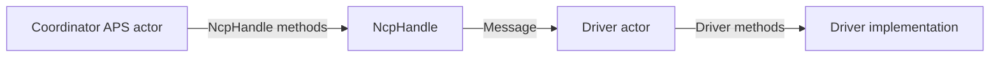
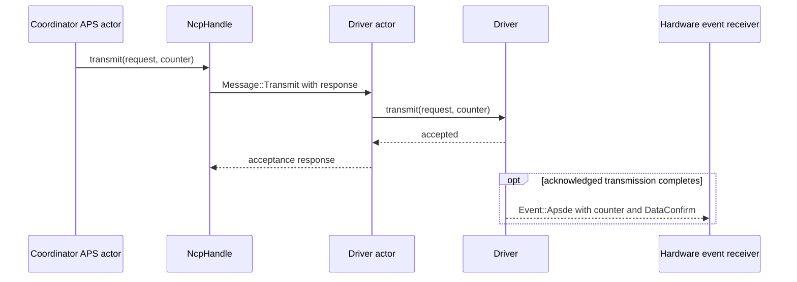
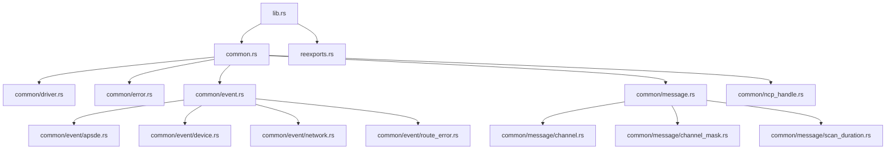
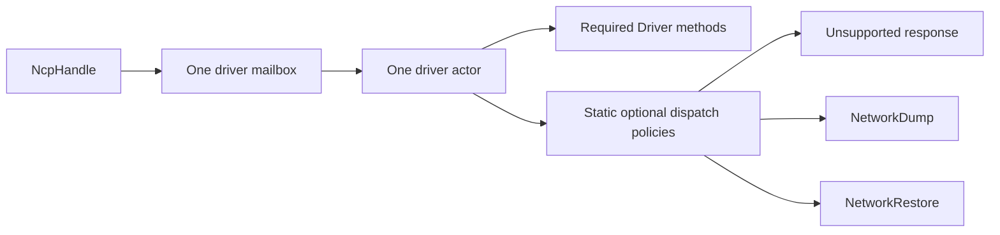
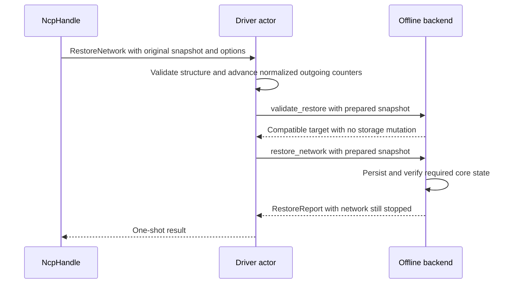

# apis-saltans-hw Architecture

`apis-saltans-hw` is the actor-oriented boundary between coordinator logic and concrete Zigbee
network co-processor drivers. Callers use the inherent methods on `NcpHandle` to enqueue commands
and receive results through one-shot channels carried by the actor messages.

## Boundaries

- The `types` feature exposes opaque actor handles, common events and errors, and typed scan values.
- The `driver` feature adds the `Driver` contract and protocol crate re-exports.
- The `coordinator` feature adds the caller-facing methods on `NcpHandle`.
- Every driver supplies its local `SimpleDescriptor` values through `Driver::get_endpoints`.
- Backends own transport startup and hardware-event conversion.
- Outgoing payloads cross the hardware boundary as
  `zb_aps::apsde::DataRequest<bytes::Bytes>` values plus an APS correlation counter.
- `Datagram`, its separate metadata, and the deferred `HwResponse` abstraction are no longer part of
  the hardware API.

## Actor Topology

`NcpHandle` is an opaque wrapper around a bounded Tokio MPSC sender. `Driver::into_actor` returns
the handle plus an unspawned future that owns the receive loop and dispatches each private `Message`
variant to the corresponding `Driver` method.

## Transmission Flow

The transmit message carries:

- an APS `DataRequest<bytes::Bytes>`
- the wrapping `u8` APS counter assigned by the coordinator APS actor
- a one-shot backend-acceptance response

`NcpHandle::transmit` awaits backend acceptance. For acknowledged APS transmissions the backend
later emits `Event::Apsde(ApsdeEvent::DataConfirm { counter, confirmation })`. The hardware
interface deliberately supplies the wrapping eight-bit APS counter alongside both the
standards-based request and confirmation because `DataConfirm` has no correlation handle.
The coordinator handles collisions when it reuses a counter. Unacknowledged transmissions emit no
APS completion event.

`Driver::transmit` reports whether the backend accepted the request. Eventual acknowledged completion
remains asynchronous.

## Other Commands

Every command carries a required response channel. `NcpHandle` creates the one-shot pair, enqueues
the message, and awaits the result.

| `NcpHandle` method | `Message` variant | `Driver` method |
| --- | --- | --- |
| `get_endpoints` | `GetEndpoints` | `get_endpoints` |
| `get_pan_id` | `GetPanId` | `get_pan_id` |
| `get_ieee_address` | `GetIeeeAddress` | `get_ieee_address` |
| `scan_networks` | `ScanNetworks` | `scan_networks` |
| `scan_channels` | `ScanChannels` | `scan_channels` |
| `allow_joins` | `AllowJoins` | `allow_joins` |
| `route_request` | `RouteRequest` | `route_request` |
| `short_id_to_ieee_address` | `TranslateIeeeAddress` | `short_id_to_ieee_address` |
| `ieee_address_to_short_id` | `TranslateShortId` | `ieee_address_to_short_id` |
| `transmit` | `Transmit` | `transmit` |

## Module Layout

`common/message.rs` defines the private actor protocol.
`common/ncp_handle.rs` defines the strong and weak handles and the caller-facing proxy methods.
`common/driver.rs` defines the public driver contract plus the actor runtime.
`common/event.rs` groups the APSDE, device, and network event categories.

## Receive-Side Events

Hardware integrations translate backend-specific events into the common `Event` model. `Event`
groups notifications into `NetworkEvent`, `DeviceEvent`, and `ApsdeEvent<T, K>` values. Incoming
application-service data uses the `ApsdeEvent::DataIndication` variant, which carries a
`DataIndication<bytes::Bytes, T, K>` and a `zdo_response_required` flag derived from backend NCP
metadata. The coordinator uses the flag only for incoming ZDO requests when deciding whether to
generate a response. Acknowledged completion uses `DataConfirm<T>` plus the coordinator correlation
counter. The generic timestamp and key-pair handle preserve backend-native representations.
Startup, event-task ownership, and backend configuration remain outside this crate.

## Error classification

The core crate owns the copyable `NetworkError` and `AcknowledgementLayer` types because their
semantics span protocol layers. APS confirmations and hardware errors both consume these shared
values without introducing a dependency from APS to hardware. The hardware crate re-exports it and adds optional
backend error sources through `Error::Network`. Command failures and asynchronous confirmations
therefore expose the same classification while retaining their original diagnostics. Classification
belongs at the backend boundary, where the status namespace is known.

## Optional core network backup

`common/backup.rs` owns versioned snapshots, validated constructors, redacted secret wrappers,
capability results, restore options/reports, and backup errors. `backup/serialization.rs` deserializes
invariant-bearing records through validation. The model deliberately excludes application state.
Backend-specific core state is carried in required namespaced/versioned extensions.

`common/driver/backup.rs` defines the independent `NetworkDump` and `NetworkRestore` traits and
`ActorBuilder`. `Driver::actor_builder` starts with two zero-sized disabled dispatch policies;
`with_network_dump` and `with_network_restore` replace them with enabled policies under the
corresponding driver trait bounds. `Driver::into_actor` uses both disabled policies. Public handles
remain opaque and independent of backend and policy types. Dispatch traits stay inside the private
implementation module; only supported marker types are exported.

All actors accept the same message enum. The added variants are `GetBackupCapabilities`,
`DumpNetwork`, and `RestoreNetwork`. Every branch responds explicitly, including unsupported
operations. The entire restore payload is boxed, avoiding backup-size-dependent mailbox slots.
Ordinary commands require no additional allocation, mailbox, or actor. Capabilities report registered
support and the common schema version; extension and firmware compatibility remain per-backup target
checks rather than a promise inferred from registration.

The receive loop awaits the operation even if the response receiver disappears. Cancellation of a
caller therefore cannot drop an in-progress hardware write future. Actor termination or power loss
can still interrupt restoration. Restore failures preserve backend sources and distinguish unchanged
storage from possibly partial state. Generic dispatch checks all normalized outgoing counters before
calling target validation; the backend checks and advances any counters encoded in opaque extensions.

The backend must keep the network offline throughout target validation, apply, verification, and any
failure. Coordinator runtime shutdown does not stop the externally owned driver, so application/backend
startup owns this maintenance lifecycle. Successful restoration does not start the network. No generic
transactional rollback is promised for NCP storage.

Counter advancement is explicit and only safe for bounded traffic since capture, including previous
restores. Incoming replay counters are retained. Stale snapshots cannot recover subsequent key or
membership changes. A backend offering live snapshots must synchronize with autonomous NCP changes;
serializing commands at the actor boundary alone does not provide snapshot consistency.
